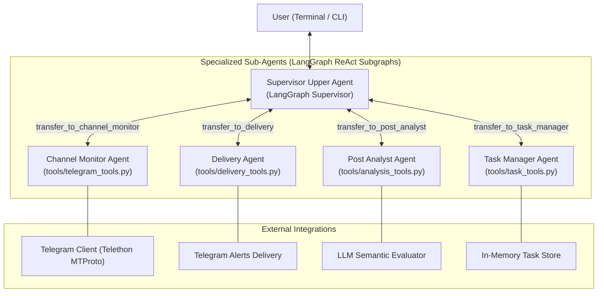

# TeleKeyword-Finder: Multi-Agent Telegram Post Discovery & Orchestration System

An intelligent multi-agent Telegram monitoring and semantic post discovery system built on **LangChain** and **LangGraph**.

When you launch the application, an interactive chat console opens in your terminal, allowing you to converse directly with the **Upper Agent (Supervisor)** in natural language. The Supervisor intelligently routes and delegates requests to specialized sub-agents running isolated LangGraph subgraphs.

---

## Architecture Overview



### Specialized Sub-Agents

1. **Upper Agent (Supervisor)**: The master coordinator. Evaluates user intent, injects real-time system metrics, and dynamically delegates to sub-agents via handoff tools (`transfer_to_*`).
2. **Task Manager Sub-Agent**: Handles full task lifecycle (creation, listing, pause, resume, cancellation, diagnostics) via `tools/task_tools.py`.
3. **Channel Monitor Sub-Agent**: Connects to Telegram channels, resolves usernames, reads unread messages, and registers real-time event listeners via `tools/telegram_tools.py`.
4. **Post Analyst Sub-Agent**: Performs semantic post relevance evaluation against user natural language criteria, batch evaluations, and fast keyword pre-filtering via `tools/analysis_tools.py`.
5. **Delivery Sub-Agent**: Formats notifications and dispatches alerts directly to Telegram recipients via `tools/delivery_tools.py`.

---

## Tool System

All operations are encapsulated into well-structured, typed `@tool` functions:

| Module | Tools | Description |
|---|---|---|
| `task_tools.py` | `create_monitoring_task`, `list_active_tasks`, `pause_task`, `resume_task`, `cancel_task`, `get_task_status` | Manages task state and metrics |
| `telegram_tools.py` | `resolve_telegram_entity`, `fetch_channel_posts`, `get_unread_messages`, `register_realtime_listener` | Telethon client operations |
| `analysis_tools.py` | `evaluate_post_relevance`, `batch_evaluate_posts`, `keyword_prefilter` | Semantic evaluation & keyword matching |
| `delivery_tools.py` | `format_post_notification`, `send_alert_to_recipient` | Alert formatting and sending |

---

## Quick Start

### 1. Requirements

- Python 3.11+
- Telegram API ID & Hash (from https://my.telegram.org)
- LLM Provider API Key (Groq, OpenAI, Google Gemini, Anthropic, or local Ollama)

### 2. Installation

```bash
git clone https://github.com/dark5087knight/TeleKeyword-Finder.git
cd TeleKeyword-Finder

# Install dependencies
pip install -r requirements.txt
```

### 3. Configuration

Copy `.env.example` to `.env` and fill in your credentials:

```dotenv
# Telegram Account Credentials
TELEGRAM_API_ID=12345678
TELEGRAM_API_HASH=abcdef0123456789abcdef0123456789
TELEGRAM_PHONE="+1234567890"

# LLM Provider & Models (groq, openai, gemini, anthropic, ollama)
LLM_PROVIDER=groq
GROQ_API_TOKEN=gsk_...
LLM_CONTROL_MODEL=llama-3.3-70b-versatile
LLM_CLASSIFIER_MODEL=llama-3.1-8b-instant

# Logging Level
LOG_LEVEL=INFO
```

### 4. Telegram Session Login

If running for the first time, authenticate your Telethon session:

```bash
python scripts/login_session.py
```

### 5. Launch Interactive Console

```bash
python app.py
```

---

## Example Usage

```text
==============================================================
TeleKeyword Finder - Upper Agent Interactive Console
==============================================================
You are now chatting with the Upper Agent powered by LangGraph.

You: Monitor @tech_news and @python_jobs for remote backend Python positions and send matches to @myusername

Upper Agent:
Monitoring task created successfully.
- Task ID: subagent_1
- Channels: @tech_news, @python_jobs
- Criteria: remote backend Python positions
- Recipient: @myusername

You: Are there any active sub-agents running right now?

Upper Agent:
Active Sub-Agents:
- Task ID: subagent_1 | State: ACTIVE | Channels: @tech_news, @python_jobs | Criteria: 'remote backend Python positions' | Recipient: @myusername | Matches found & delivered: 0

You: Pause subagent_1

Upper Agent:
Task 'subagent_1' is now PAUSED.
```

---

## Running Tests

Run the test suite using pytest:

```bash
python -m pytest tests/test_migration.py -v
```
